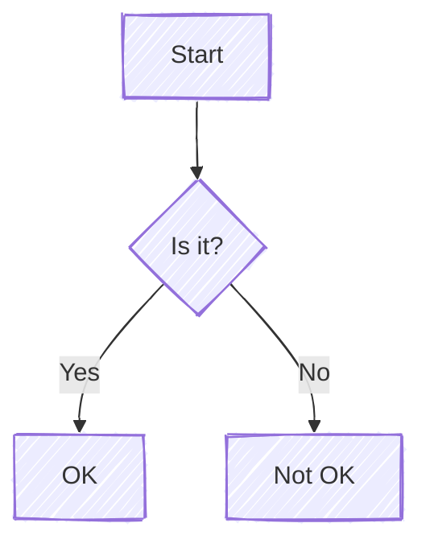
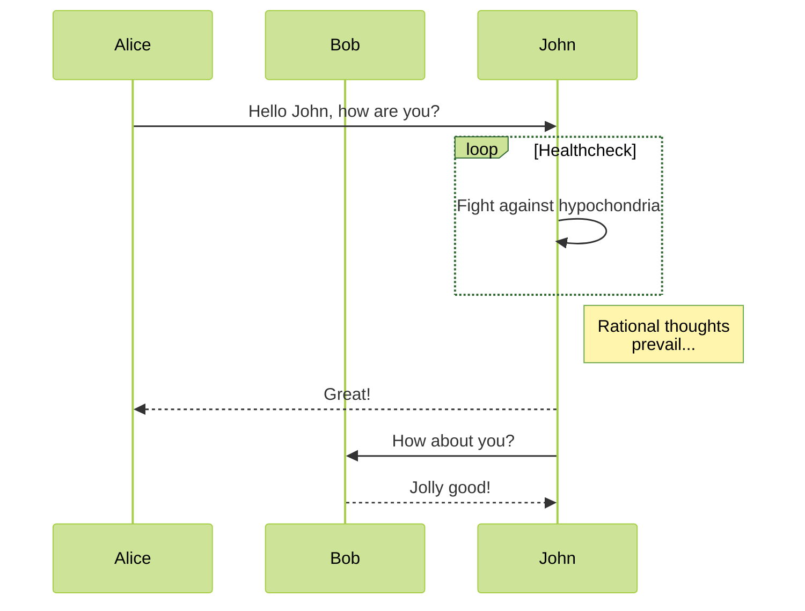
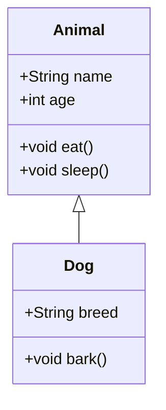
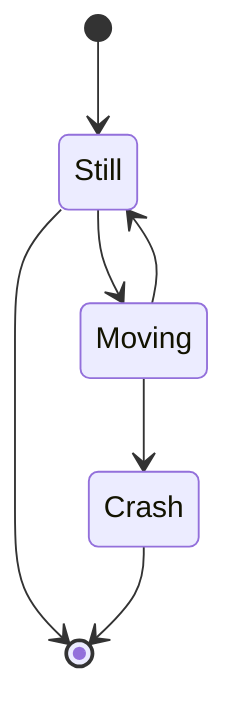
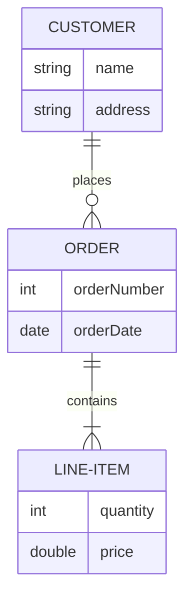
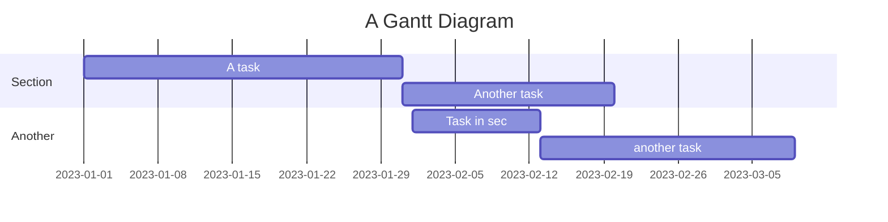
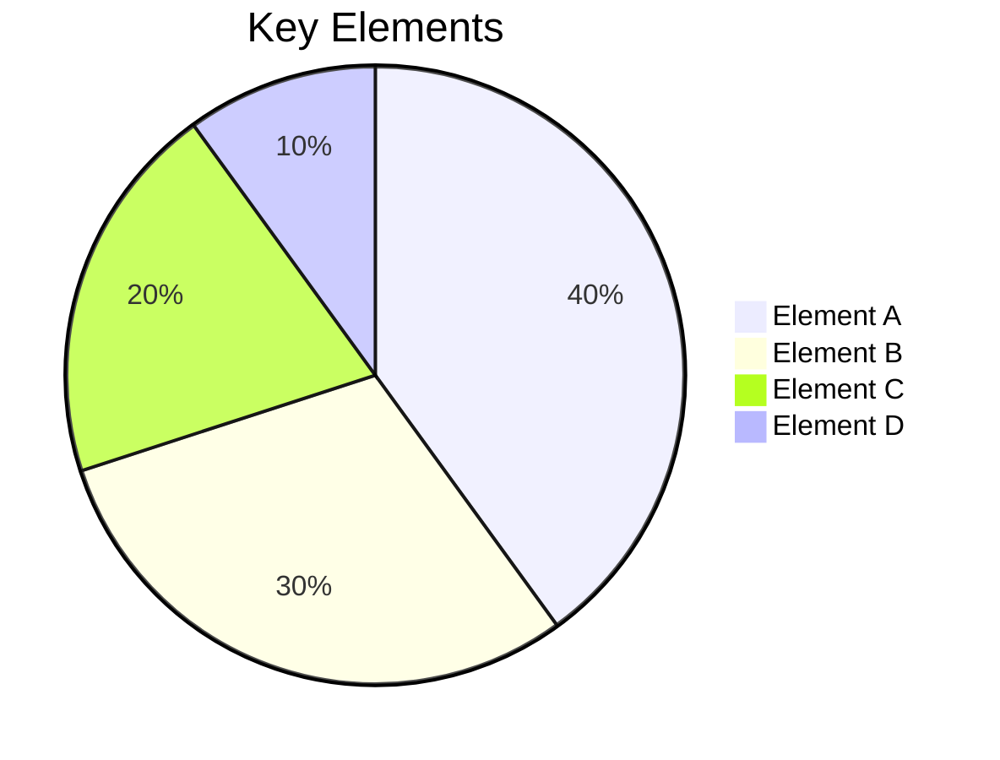
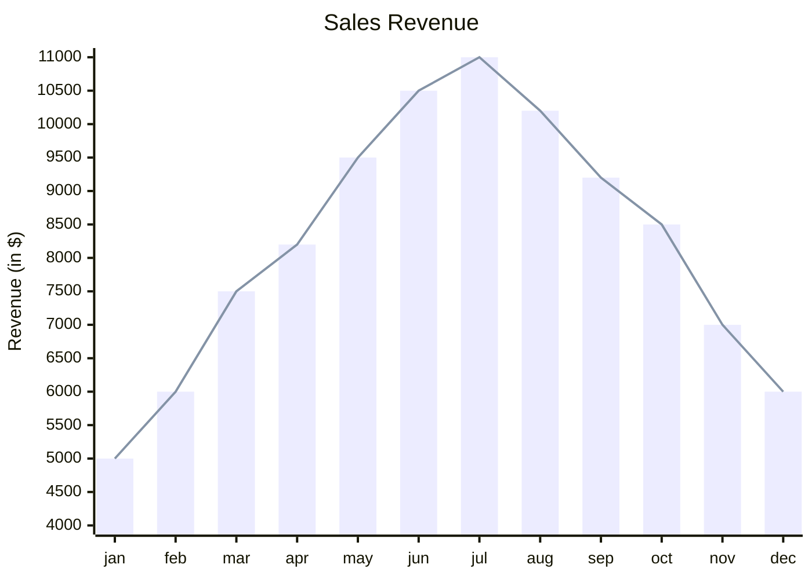
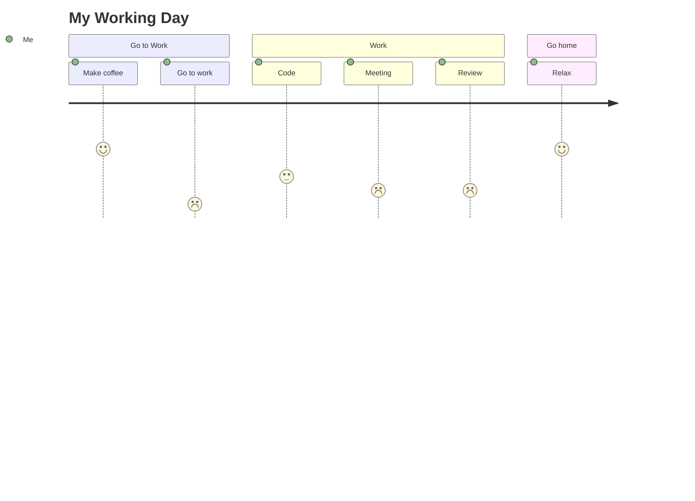

# Introduction to Mermaid Diagrams

Mermaid is a JavaScript-based diagramming and charting tool that renders Markdown-inspired text definitions to create and modify diagrams dynamically. It is a powerful tool for creating UML diagrams directly within Markdown files.

## Supported UML Diagrams

### 1. Flowchart

### 2. Sequence Diagram

### 3. Class Diagram

### 4. State Diagram

### 5. Entity Relationship Diagram

### 6. Gantt Chart

### 7. Pie Chart

### 8. XY Chart

### 9. Journey Diagram

Mermaid provides a versatile way to create various types of diagrams using simple text syntax. For more details, visit the [Mermaid documentation](https://mermaid-js.github.io/mermaid/#/).